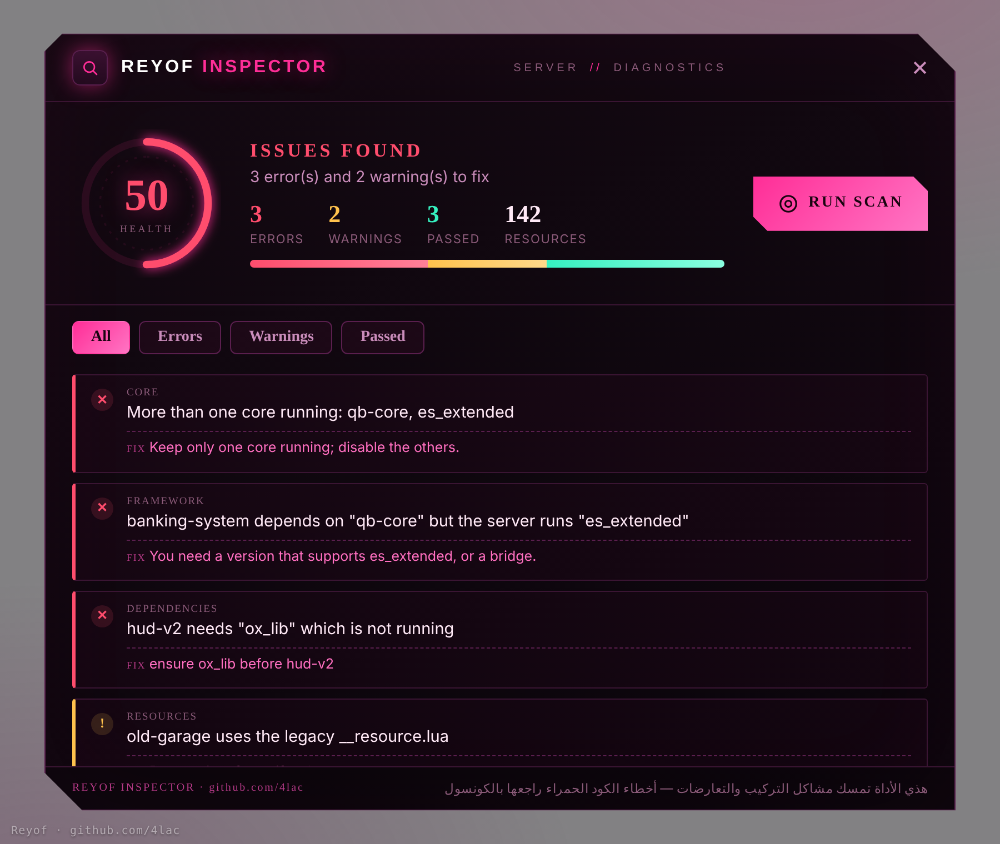

# Reyof Inspector

فحص شامل لأي سيرفر **FiveM** — يكتشف الأخطاء ويطبعها لك بصفحة ملونة + في الكونسول.

**by [Reyof](https://github.com/4lac)**



## وش يفحص؟

- **الكور** — يكتشف الكور الشغّال، وينبّه لو فيه أكثر من كور (تعارض) أو ولا واحد.
- **تعارض الإطار** — يكشف سكربت لإطار مختلف عن سيرفرك (مثلاً سكربت qb في سيرفر ESX).
- **الأساسيات** — ox_lib · oxmysql · التارقت · الإنفنتوري.
- **حالة الموارد** — سكربتات missing / error / stopped.
- **الاعتماديات** — dependency معلن بس مو شغّال.
- **المانفست** — __resource.lua قديم أو fx_version قديم.
- **الداتابيس** — صحة الاتصال.

## التركيب

1. حط المجلد `reyof-inspector` في `resources`.
2. في `server.cfg`:
   ```
   ensure reyof-inspector
   ```
3. ريستارت.

## الاستخدام

- داخل اللعبة (أدمن): `/inspector`  أو  `/inspect`
- في الكونسول: `inspector`
- يطبع تقرير مختصر تلقائي بعد تشغيل السيرفر (تعدّله من `config.lua`).

## الصلاحيات

يفتحه الأدمن (صلاحيات ACE)، أو تحط أيدي ديسكورد في `config.lua` > `Config.AdminDiscord`.

## ملاحظة مهمة

الأداة تمسك **فقط** المشاكل اللي الكونسول ما يوضحها: التركيب، الاعتماديات، التعارضات، الكور.
أخطاء الكود اللي تطلع حمراء في الكونسول (SCRIPT ERROR) تنطبع هناك أصلاً — راجعها في الكونسول.
يعني الأداة **تكمّل** الكونسول، ما تكرّره.

---

© 2026 Reyof · github.com/4lac — الحقوق محفوظة، ممنوع حذف الحقوق من الكود.
